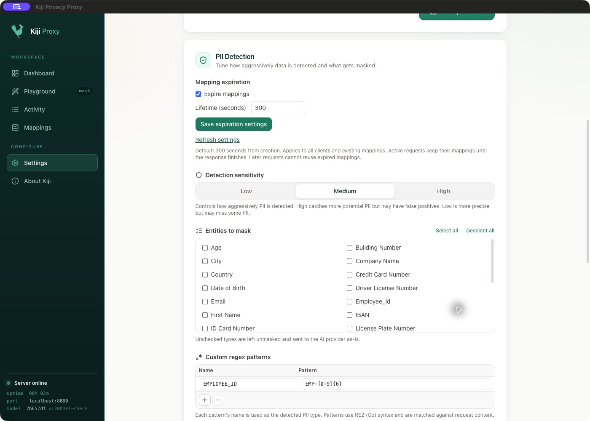
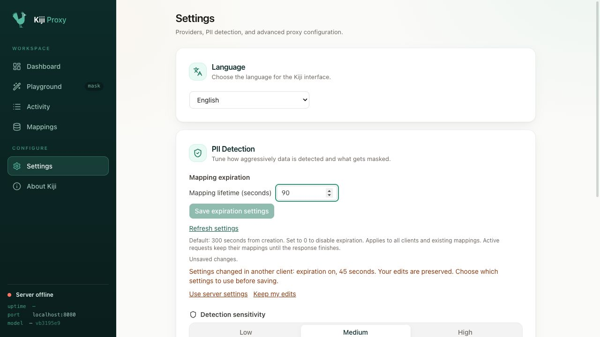

# Masking Controls & Review

This chapter covers the controls that decide **what** Kiji masks and let you **review** what it has masked:

- Group detection settings into named **PII profiles** and pick one per request
- Tune detection sensitivity
- Disable specific entity types so they are sent through unmasked
- Add your own regex patterns for PII the model doesn't cover
- Review, sort, and delete recorded original → masked mappings

## Table of Contents

- [Where to find these controls](#where-to-find-these-controls)
- [PII profiles](#pii-profiles)
- [Mapping expiration](#mapping-expiration)
- [PII detection sensitivity](#pii-detection-sensitivity)
- [Choosing which entities to mask](#choosing-which-entities-to-mask)
- [Custom regex patterns](#custom-regex-patterns)
- [Reviewing and deleting masked entities](#reviewing-and-deleting-masked-entities)
- [For standalone / automation](#for-standalone--automation)

---

## Where to find these controls

These controls live in the **macOS desktop app** (the Electron UI). Open them from the hamburger **menu** in the top-left of the window:

| Control | Path |
|---------|------|
| PII profiles: detection sensitivity, entities to mask, custom regex | **Menu → Settings → PII Detection** |
| Review / delete masked mappings | **Menu → Mappings** |

> The PII Settings and Mappings screens are part of the desktop UI. If you run the standalone backend (Linux/headless), configure the same behavior through the config file and HTTP API — see [For standalone / automation](#for-standalone--automation).

<!-- Screenshot: PII Settings modal showing the Detection Sensitivity, Entities to Mask, and Custom Regex Patterns sections -->

---

## PII profiles

Different applications need different masking. A healthcare app might want high sensitivity plus custom patterns for medical record numbers, while a consumer chat app might leave company names unmasked. A **PII profile** is a named set of:

- detection sensitivity (one confidence threshold),
- entities to mask, and
- custom regex patterns.

Exactly one profile is the **default**. It applies to every request that doesn't name a profile, so a fresh install behaves exactly as before.

In **Settings → PII Detection**:

- Pick the profile to edit from the **Profile** dropdown. The default is marked "(default)".
- **New profile** creates one with default settings. Rename it in the **Profile name** field.
- **Set as default** makes the selected profile the default.
- **Delete** removes the selected profile (click twice to confirm). The default profile can't be deleted.

Every profile has a stable **ID**, shown under its name (e.g. `X-Kiji-Profile: healthcare`). The ID is derived from the first name and never changes, so renaming a profile doesn't break clients that refer to it.

### Choosing a profile per request

- **Playground:** pick a profile from the **Profile** dropdown next to **Send to**. The result shows which profile was applied.
- **Proxied API requests:** send the `X-Kiji-Profile` header with the profile ID. Kiji strips the header before forwarding to the provider.

  ```bash
  curl http://localhost:8080/v1/chat/completions \
    -H "Authorization: Bearer $OPENAI_API_KEY" \
    -H "Content-Type: application/json" \
    -H "X-Kiji-Profile: healthcare" \
    -d '{"model": "gpt-4o-mini", "messages": [{"role": "user", "content": "..."}]}'
  ```

- **Chrome extension:** choose the profile in the extension's settings (see [Chrome Extension](06-chrome-extension.md)).

A request that names a profile that doesn't exist is **rejected with HTTP 400** rather than silently masked with other settings.

Profiles are stored in `pii_profiles.json` in the application data directory. On the first start after upgrading, Kiji creates a `Default` profile (ID `default`) from your previous settings in `pii_settings.json`. The old file is left in place. If loading, validation, or migration (including saving the migrated profiles) fails, startup stops with an error. Repair the file or filesystem problem and restart; the proxy never substitutes static settings after a profile-loading failure.

---

## Mapping expiration

On fresh installs, mappings expire **300 seconds after creation** by default. Set the duration as a
whole number of seconds (0–2147483647). **0 disables expiration**; any positive
value enables it. Both apps have one lifetime field, with no separate toggle:

- **Mac app:** Settings → PII Settings → Mapping expiration → Save expiration settings.
- **Chrome extension:** Settings → Mapping expiration → Save expiration settings.
- **Linux server:** add this block to the JSON file passed to `-config`:

```json
{
  "mapping_expiration": {
    "ttl_seconds": 300
  }
}
```

Both UIs read and change the connected server's policy, so it applies to all its
clients. Changes take effect without restarting and apply to existing mappings
based on their original creation time. SQLite is the single source of truth for
the policy. UI changes are saved directly to the database. An explicit
`mapping_expiration` in the config updates the database policy at startup;
omitting it keeps the saved value. A new database defaults to 300 seconds.
The development config omits this setting so UI changes survive app restarts.
Applying a shorter TTL or enabling expiration at startup deletes mappings already
past that lifetime, just as a UI save does; startup logs report changes to the saved policy.
`pii_profiles.json` stores detection profiles separately from the expiration policy.
Profile-loading failures stop startup without changing the saved expiration policy.
Once profiles have been migrated, the legacy `pii_settings.json` is no longer used.
An omitted duration defaults to 300 seconds; negative, fractional, and excessive
durations are rejected. An unreadable or invalid explicit `-config` file stops
startup instead of silently using defaults. There is no `enabled` parameter.
Saving entity or regex settings does not change the database policy.

The Mac settings refresh when the window regains focus or becomes visible, and
every five seconds while Settings remains visible. A
refresh preserves unsaved edits; if another client changed the policy, choose
**Use server settings** or **Keep my edits** before saving. Saves check the policy
the editor originally loaded, so changes arriving just before a save are also
detected. Chrome reports conflicting saves and lets you reload the server settings.
Mac settings requests time out after ten seconds, allowing polling to recover
without discarding drafts. Superseded requests are cancelled, and late responses
cannot overwrite newer settings. A timed-out save remains uncertain until a
refresh confirms it. If a later retry receives a definite server error, the UI
shows that error while still reconciling the earlier save and preserving newer edits.

The Mac app exposes the shared lifetime in seconds:



If another client saves 45 seconds while the Mac app has an unsaved 90-second
draft, the draft is preserved and saving pauses until the conflict is resolved:



Expiration is checked when a masking request or standalone unmask operation
starts, on global mapping lookups, on mapping list/count reads, and on policy
changes. A policy
change removes rows expired under either the old or new policy in one
transaction; extending or disabling expiration cannot revive them. The previous
policy is retained in the database so changing the config during a restart
cannot revive them either. A background cleanup runs every second, independently
of request traffic, and retries after database contention. This removes expired
rows even on idle servers; it does not guarantee immediate secure erasure from
SQLite files or backups. Active request snapshots retain their original view. Masking
an expired original creates a new mapping. Unmasking an expired dummy returns
not found. Reads do not renew
the lifetime. Turning expiration off retains mappings until they are deleted;
it does not recover expired rows. This setting controls mappings, not the
separate activity logs.

Placeholders become reusable when their mappings expire or are deleted. If a
candidate belongs to another live mapping, Kiji retries the generator up to eight
times before using a fresh opaque `[REDACTED_…]` token. A repeated candidate
immediately triggers that fallback without another lookup of the same value. No permanent reservation
table is retained. A standalone unmask of an old placeholder can therefore return
a newer person's value after reuse. Active responses still use their own saved
pairs and restore the original person, even if the placeholder has been reassigned.
Existing live mappings keep their placeholders during migration.

Each proxied request takes a mapping snapshot before detection and uses it
across all message fields. The mappings actually used by that request remain
available in memory through the upstream wait and the complete response,
including streamed deltas, final payloads, tool arguments, and buffered replies.
Expiration, deletion, or an expiration-settings change during the request does
not change those mappings. After the request finishes, its snapshot is discarded;
a later request or standalone unmask call cannot reuse an expired pair. A
standalone batch unmask also uses one snapshot for its whole operation.

The database snapshot stays open only during detection and masking. Indexed
lookups read just the detected values, and a per-request cache reuses them across
fields. Before waiting for the upstream response, the database snapshot closes;
only used pairs remain in the response map. Standalone unmasking likewise reads
only the requested dummy values and returns a service error if the database read
fails, rather than reporting those values as missing.

Read connections are capped at 16. Acquisition occurs before detection, observes
request cancellation, and waits at most five seconds for a slot. This acquisition
deadline does not shorten an acquired snapshot's lifetime. Exhausted acquisition
or failed mapping reads return HTTP 503 without forwarding the request.
Cancellation stops remaining lookups and mapping creation. Long detection inference can
still delay WAL checkpoints; snapshots close before the upstream wait.

Taking a snapshot is read-only. Each reused pair is counted once per masking
request or standalone unmask batch. Counts are updated in one best-effort batch
by a background worker after closing the snapshot. Requests never wait for this
write. The worker uses a separate connection with a fixed 100-millisecond busy
timeout and a 100-millisecond operation budget. Its queue holds at most 64 batches;
batches exceeding 1024 pairs or 128 KiB are skipped. Counts may be dropped under
load or at shutdown, but cannot discard resolved unmask results.
Response restoration does not touch the database or inflate access statistics.
In addition to periodic cleanup, mapping creation, list/count reads, and policy
changes retire expired rows. Missing or expired snapshot
lookups do not issue cleanup writes.
The request snapshot neither renews timestamps nor recreates expired rows.
Stream audit logs capture exactly the restored deltas and flushed tails emitted
to the client, without duplicating final payloads.

For automation, `GET /api/pii/mapping-expiration` returns the active
`{ "ttl_seconds": 300 }` policy. `POST` to the same endpoint with
`{ "ttl_seconds": 0 }` to disable expiration, or a positive duration to enable it.
The route is available on both proxy ports.
It uses the same CORS handling as the other API endpoints.
Interactive clients also send an `expected` object containing the last loaded
`ttl_seconds` value. If this differs from the current policy, the
server returns HTTP 409 with the current policy and makes no changes. Omitting
`expected` allows unconditional updates for automation.

---

A save with an unconfirmed response may already have been applied. The Mac app
explains this uncertainty and checks the server before retrying. When the server
matches the submitted policy, the app accepts it while preserving any newer
local edits. Different server settings still require conflict resolution.

Profile saves report persistence errors and retain the previous runtime values
on failure. Repair invalid profile files before restarting; the expiration policy
remains in SQLite. Saving replaces the file without reading it first; write failures
are reported.

## PII detection sensitivity

The **Detection sensitivity** selector controls how aggressively the selected profile flags PII. It maps to a minimum confidence threshold:

| Setting | Threshold | Behavior |
|---------|-----------|----------|
| **High** | 0.1 | Catches more potential PII, but may have more false positives |
| **Medium** | 0.25 | Balanced detection (default) |
| **Low** | 0.5 | More precise, but may miss some PII |

Lower the threshold if PII is slipping through; raise it if too many harmless tokens are being masked.

---

## Choosing which entities to mask

The **Entities to Mask** section lists every entity type the selected profile can detect: the loaded model's types plus the profile's custom regex names (26 model types for the default model — names, emails, phone numbers, SSNs, credit card numbers, and so on). Each type has a checkbox:

- **Checked** (default) — the type is masked before the request is forwarded.
- **Unchecked** — the type is **left unmasked and sent to the AI provider as-is**.

Use **Select all** / **Deselect all** for quick changes. Changes are saved automatically (a "Setting saved." confirmation appears).

By default every type is masked. Kiji stores your choice as an *exclusion list* (the types you unchecked), so a fresh install never leaks PII by accident — you have to explicitly opt a type out of masking.

**Example:** if your workflow legitimately needs the model to see company names, uncheck **Company Name**. Emails, SSNs, and everything else still get masked.

<!-- Screenshot: Entities to Mask checkbox grid with one type unchecked -->

---

## Custom regex patterns

The model covers common PII, but you may have domain-specific identifiers it doesn't know about — internal employee IDs, ticket numbers, project codenames. The **Custom Regex Patterns** section lets you add those to the selected profile. Patterns only run for requests that use that profile.

Each pattern is a row with two fields:

| Field | Meaning |
|-------|---------|
| **Name** | Becomes the detected PII type (e.g. `EMPLOYEE_ID`). Shown as the entity type in logs and the Mappings table. |
| **Pattern** | A regular expression in **RE2 (Go) syntax**, matched against the request content. |

To manage patterns:

1. Click **+** to add a row.
2. Fill in both the **Name** and **Pattern** — a row is only saved once both fields are complete.
3. To remove a pattern, click the row to select it, then click **−**.

Custom patterns run **in addition to** the ML model, so anything they match is masked alongside model-detected PII. If a pattern can't be compiled, Kiji rejects the change and shows: *"Failed to save patterns. Check that each name and pattern is a valid RE2 expression."*

**Example** — mask internal employee IDs like `EMP-4821`:

| Name | Pattern |
|------|---------|
| `EMPLOYEE_ID` | `EMP-\d{4}` |

> RE2 does not support backreferences or lookarounds. See the [RE2 syntax reference](https://github.com/google/re2/wiki/Syntax) for what's available.

<!-- Screenshot: Custom Regex Patterns table with an EMPLOYEE_ID row -->

---

## Reviewing and deleting masked entities

Every time Kiji masks a value, it records the original → masked pair so it can restore the original in the provider's response. The **PII Mappings** screen (**Menu → Mappings**) lets you review and manage those records.

The table has four sortable columns — click the arrows in any header to sort:

| Column | Description |
|--------|-------------|
| **Entity Type** | The PII type (model label or custom-regex name) |
| **Original** | The original value Kiji saw |
| **Masked** | The dummy value sent to the provider in its place |
| **Date of first entity** | When this mapping was first created |

Large histories are paginated — click **Load More Mappings** to fetch the next page. The footer shows "Showing N of total".

### Deleting a single mapping

Hover over a row and click the trash icon, then confirm at the inline **Delete?** prompt.

### Clearing all mappings

Click **Clear All** in the header and confirm in the **Clear All Mappings?** dialog. This permanently removes every recorded mapping and cannot be undone.

**What deleting means:** removing a mapping deletes the original ↔ masked pair. The next time Kiji encounters that original value it generates a *new* mask rather than reusing the old one. Deleting does not change a request that is already in flight.

<!-- Screenshot: PII Mappings modal with the sortable table, a row's delete confirmation, and the Clear All button -->

---

## For standalone / automation

The desktop screens above are thin clients over the backend's HTTP API. When you run the standalone backend, drive the same behavior through the config file and the API (served on `PROXY_PORT`, default `:8080`).

**Initial settings via the config file**: on first start (when no `pii_profiles.json` exists yet), the default profile is seeded from `custom_regexes` and `disabled_entities` in the config file:

```json
{
  "custom_regexes": [
    { "name": "EMPLOYEE_ID", "pattern": "EMP-\\d{4}" }
  ],
  "disabled_entities": ["COMPANYNAME"]
}
```

**HTTP API:**

```bash
# List profiles (IDs, names, and the default ID)
curl http://localhost:8080/api/pii/profiles

# Create a profile; the response contains its generated "id" (here: "healthcare").
# confidence: 0.1 = high, 0.25 = medium, 0.5 = low sensitivity (0.05–0.95).
# Invalid RE2 patterns or unknown entity types return HTTP 400; a duplicate name returns 409.
curl -X POST http://localhost:8080/api/pii/profiles \
  -H "Content-Type: application/json" \
  -d '{"name": "Healthcare", "confidence": 0.1,
       "disabled_entities": ["COMPANYNAME"],
       "custom_regexes": [{"name": "MRN", "pattern": "MRN-\\d{6}"}]}'

# Read, update (including rename), or delete a profile by ID.
# PUT replaces all fields; the default profile can't be deleted (409).
curl http://localhost:8080/api/pii/profiles/healthcare
curl -X PUT http://localhost:8080/api/pii/profiles/healthcare \
  -H "Content-Type: application/json" \
  -d '{"name": "Hospital", "confidence": 0.25, "disabled_entities": [], "custom_regexes": []}'
curl -X DELETE http://localhost:8080/api/pii/profiles/healthcare

# Make a profile the default (used when a request names no profile)
curl -X POST http://localhost:8080/api/pii/profiles/healthcare/default

# Entity types selectable for a profile (model types + the profile's regex names)
curl "http://localhost:8080/api/pii/entities?profile=healthcare"

# Check text for PII with a specific profile (omit "profile" for the default)
curl -X POST http://localhost:8080/api/pii/check \
  -H "Content-Type: application/json" \
  -d '{"message": "Patient MRN-123456", "profile": "healthcare"}'

# Review mappings (supports limit, offset, sort, order)
curl "http://localhost:8080/mappings?limit=50&offset=0&sort=created_at&order=desc"

# Delete one mapping by id, or clear them all
curl -X DELETE "http://localhost:8080/mappings?id=123"
curl -X DELETE "http://localhost:8080/mappings"

# Resolve a masked (dummy) value back to the original PII. Single value returns
# {"masked", "original", "found"} (404 if unknown); an array returns a per-item
# "results" list plus "found_count". Requires Basic Auth when it is enabled.
curl -X POST http://localhost:8080/api/mappings/unmask \
  -H "Content-Type: application/json" \
  -d '{"masked": "Nicole Brown"}'
curl -X POST http://localhost:8080/api/mappings/unmask \
  -H "Content-Type: application/json" \
  -d '{"masked": ["Nicole Brown", "nicole.brown@example.invalid"]}'
```

> Profile changes are persisted to `pii_profiles.json` and survive restarts. When Basic Auth is enabled, creating, updating, deleting, and setting the default profile require credentials; listing profiles and `/api/pii/check` stay open.
>
> The legacy endpoints `POST /api/pii/entities`, `/api/pii/regexes`, and `/api/pii/confidence` have been removed. Use the profile endpoints above instead.

---

## See also

- [Getting Started](01-getting-started.md) — installation, first run, configuration
- [Customizing the PII Model](07-customizing-pii-model.md) — train a model with your own entity types
